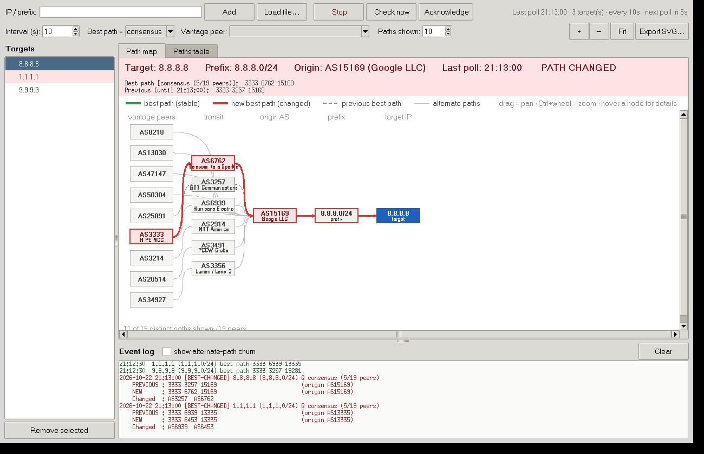
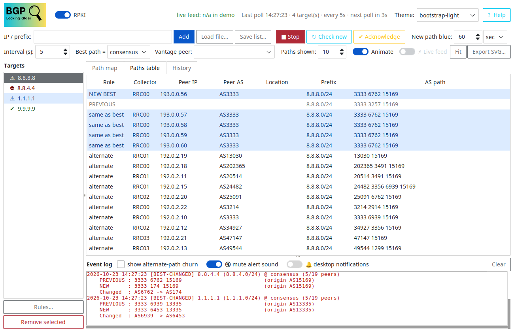
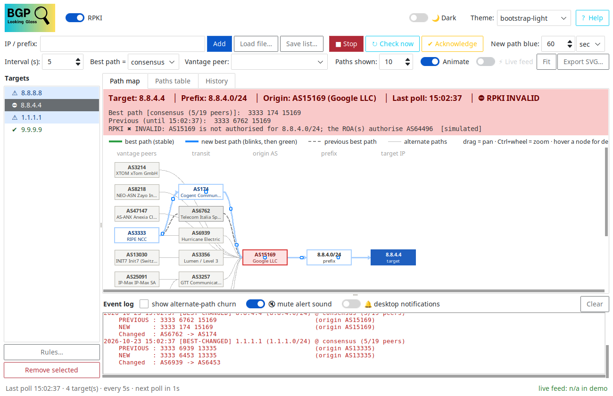
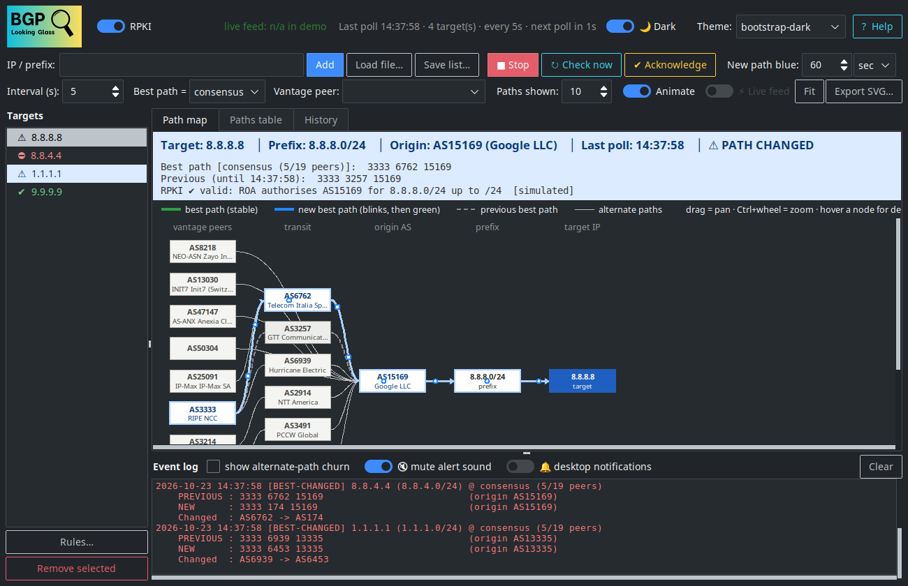
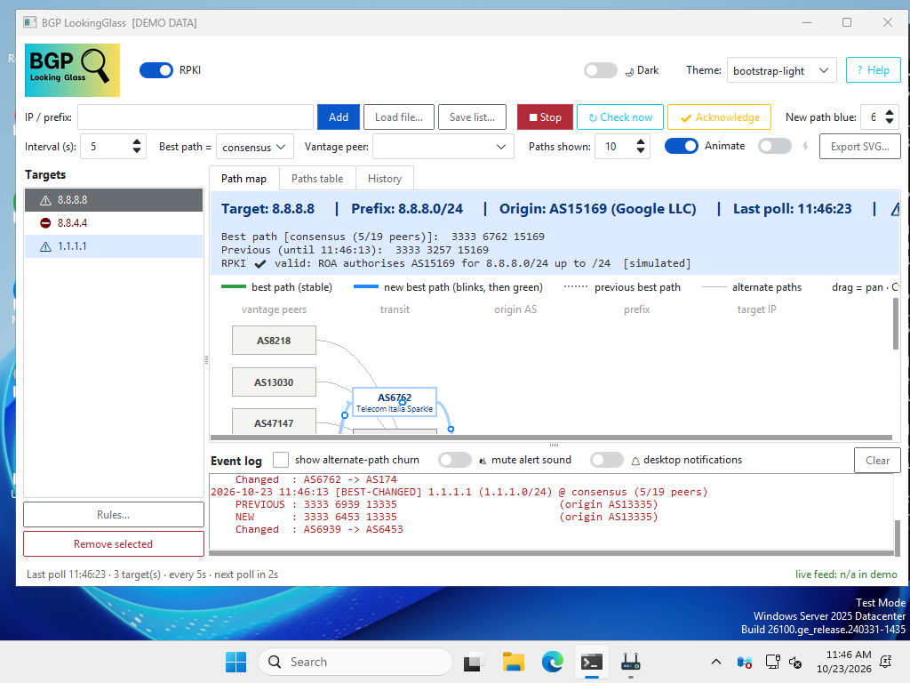

# BGP LookingGlass

A live BGP **AS-path map** for one or many IP addresses, in the spirit of the
classic looking-glass "bgpmap" view, with alerts when the best path changes.

- Map: vantage peers → transit ASes → origin AS → prefix → target IP
- **Green** = best path (stable) · **Blue, blinking** = new best path after a change (turns green by itself after the time set in *New path blue*; 0 = until acknowledged) ·
  **Dashed grey** = previous best path · thin grey = alternate paths
  (thicker = more peers use that link)
- Every change is dumped to the console and to log files with the
  **previous AS path, the new AS path and the hops that changed**
- Several targets at once; each has a status in the side list
  (✔ stable, ⚠ changed, ✖ error) and its own map
- **RPKI origin validation** of the best path (valid / INVALID / not found) with an `RPKI_INVALID` alert
  for hijack-like announcements; switch on/off with the *RPKI* toggle in the window (or `--no-rpki`)
- **Expected-path rules** per target (origin AS, must pass through, must not
  pass through, max length) raise a `RULE-VIOLATION` alert when the best path breaks them
- **History**: every change is stored with a snapshot, shown as a timeline;
  select an event to redraw the map as it was
- Three-beep alert sound (global mute and per-target mute), dark/light switch,
  targets/rules remembered between sessions
- A router icon in the system tray (lamp colour = alert state; menu: show/hide, check now, quit; `--no-tray` to disable)
- Runs on Linux and Windows. Python + Tkinter. Optional [ttkbootstrap](https://ttkbootstrap.rdbende.dev/) gives a modern themed UI (see below); no Graphviz.

Data comes from the free [RIPEstat Looking Glass API](https://stat.ripe.net/docs/data-api/api-endpoints/looking-glass)
(RIPE RIS route collectors, hundreds of peers worldwide).

## Screenshots

Demo data (`./main.py --demo`), so you can reproduce them without waiting for a real BGP event.

**A new best path** - blinking blue (then green), the previous path dashed grey, packets travelling
along the new path, the RPKI result and the change written to the event log:



**Paths table** - every peer's route as NEW BEST / PREVIOUS / alternate:



**RPKI invalid** - the origin AS is not authorised by any ROA, so the origin box turns red and the
target is flagged `RPKI INVALID`:



**Dark mode** - the **🌙 Dark** switch (top right) flips the theme to its dark twin:



**On Windows** - the single-file `.exe` running on Windows (this screenshot is taken by the CI build
on a Windows runner, so it is what the released file really does):



## Install & run (Windows 10 / 11)

**Easiest - the ready-made `.exe`** (no Python needed): download `bgpwatch-<version>-windows-x64.exe`
from the [Releases](https://github.com/dcenterd/bgpwatch/releases) page and double-click it. It is a single
self-contained file, so it opens a little slower than an installed app the first time (it unpacks itself).
Add targets in the window, or try the simulated data first from a Command Prompt:
`bgpwatch-<version>-windows-x64.exe --demo --ips 8.8.8.8,8.8.4.4,1.1.1.1 --interval 10`.
Windows SmartScreen or your antivirus may warn about an unsigned app: *More info → Run anyway*. If your
antivirus objects to the single file, use `bgpwatch-<version>-windows-x64-folder.zip` instead: unzip it and
run `bgpwatch\bgpwatch.exe` (the same app, starts faster).

**From source** - install Python 3.8+ from [python.org](https://www.python.org/downloads/) (it includes
Tkinter; tick *Add python.exe to PATH*), then:

```bat
git clone https://github.com/dcenterd/bgpwatch.git
cd bgpwatch
run_windows.bat
```

`run_windows.bat` creates a `.venv` and installs the packages on the first run, then starts the app
without a console window. Extra options go after it: `run_windows.bat --demo --ips 8.8.8.8`.

On Windows the alert sound uses the built-in `winsound`, desktop notifications are balloons from the
**system-tray icon** (so they need the tray icon, i.e. not `--no-tray`), and files live in
`%LOCALAPPDATA%\bgpwatch\` (logs, history, settings; AS-name cache in `cache\`). To build the `.exe`
yourself: `packaging\build_windows.bat`.

## Install & run (Ubuntu / Debian)

```bash
sudo apt install python3-tk python3-venv git      # Tkinter + venv, if not installed
git clone https://github.com/dcenterd/bgpwatch.git && cd bgpwatch
python3 -m venv --system-site-packages .venv && .venv/bin/pip install -r requirements.txt
./main.py --ips 8.8.8.8,1.1.1.1      # or just ./main.py and add IPs in the window
```

`main.py` automatically uses the project's `.venv` if there is one. The optional packages in
`requirements.txt` add: **ttkbootstrap** (themes, round toggles, coloured buttons), **Pillow**
(the logo) and **pystray** (the router icon in the system tray). Without them the app still works,
with the plain Tk look, a text title and no tray icon.

On GNOME the tray icon needs the AppIndicator support that Ubuntu ships
(`gir1.2-ayatanaappindicator3-0.1`); on other desktops any StatusNotifier-capable tray works.
Desktop notifications use `notify-send` (`libnotify-bin`) and the alert sound uses
`pw-play`, `paplay` or `aplay`.

Try it without waiting for a real BGP event (simulated data, a change every 3 polls):

```bash
./main.py --demo --ips 8.8.8.8,8.8.4.4,1.1.1.1 --interval 10
```

(`8.8.4.4` is deliberately shown as an RPKI-invalid hijack in demo mode.)

Fedora: `sudo dnf install python3-tkinter` · Arch: `sudo pacman -S tk`

## What "best path" means

A public looking glass shows routes from many routers, and each router picks
its own best path. Choose how the app decides:

| Mode | Best path is… | Use it when |
|---|---|---|
| `consensus` (default) | the AS path used by the most peers (ties → shorter path) | you want "how the Internet reaches this IP" |
| `peer` | the route seen by one collector/peer, e.g. `RRC00/193.0.0.56` (RIPE NCC, Amsterdam) | you want one router's best-path decision, like a single looking glass |

In the GUI pick the mode and the vantage peer in the toolbar; on the
command line use `--mode peer --vantage RRC00/193.0.0.56`.

## The window

| Area | What it shows |
|---|---|
| Header (green/red/amber) | Target IP, prefix, origin AS, last poll, status; the best path and, after a change, the previous one |
| Path map | The graph. Drag to pan, Ctrl+wheel or +/− to zoom, **Fit** to fit, hover a node for AS name, role and how many peers use it |
| Paths table | Every peer's route: NEW BEST / BEST / PREVIOUS / alternate |
| Targets list | Click a target to show its map. A red entry has an unacknowledged change |
| Event log | First-seen, path changes (red), errors. Tick *show alternate-path churn* to also see non-best path updates |

| History | Timeline and table of every recorded change, rule violation and first-seen. **Show map at that time** (or double-click a row) redraws the map from that moment; **Exit replay** returns |

### Rules, mute, themes

- **Rules…** (button under the target list, or right-click a target): expected
  origin AS, ASes the best path must pass through (all), ASes it must not
  contain (any), and a max length. A broken rule turns the target red (⛔),
  logs `RULE-VIOLATION`, beeps and notifies; `RULE-RESTORED` follows when it
  complies again. Tick *apply to all targets* to copy the rules to every target.
- **Mute**: *mute alert sound* silences everything; right-click a target →
  *Mute alerts for this target* (🔕) silences just that one (sound and desktop
  notification - it is still logged and shown in red).
- **⚡ Live feed** switches from polling to [RIPE RIS Live](https://ris-live.ripe.net/):
  the table is seeded once from RIPEstat, then each target follows its own
  stream of BGP updates, so a change is seen within seconds instead of at the
  next poll (the interval then acts only as a safety re-check). The title row
  shows `streams live · updates · last update`. Not available in `--demo`.
  Very unstable prefixes can flap many times a minute - use `--confirm N` to
  require a new path to hold for N checks before alerting.
- **Theme** (top right): 30 themes, half of them dark. The **🌙 Dark** switch next to it flips the
  current theme to its dark or light twin (e.g. `nord-light` ↔ `nord-dark`).
- **Save list…** writes the targets to a text file that **Load file…** can read back. Targets, rules,
  mutes and the theme are restored on the next start (`--no-restore` to skip).
- `--minimized` starts the window minimised.

### Help

**? Help** (top right, or **F1**) opens a window with three tabs: *How it works* (the data
flow, step by step), *Component diagram* (every module drawn with its connections - click a box
to highlight what it talks to; save as SVG) and *Module matrix* (which module imports which,
generated from the real source code; save as CSV).

**Acknowledge** ends the blue blinking at once (it also ends by itself after *New path blue* seconds/minutes, default 60 s; packets animate along the best path, switch with *Animate*). It clears the changed state of the selected target (or use
`--auto-ack N` to clear it after N stable polls). **Export SVG** saves the
current map, named `<ip>_<date>_<time>.svg`.

## Console / log output

```
2026-10-22 21:13:00 [BEST-CHANGED] 8.8.8.8 (8.8.8.0/24) @ consensus (5/19 peers)
    PREVIOUS : 3333 3257 15169                          (origin AS15169)
    NEW      : 3333 6762 15169                          (origin AS15169)
    Changed  : AS3257 -> AS6762
```

Event types: `FIRST-SEEN`, `BEST-CHANGED`, `ORIGIN-CHANGED` (origin AS
changed: possible hijack/misorigination), `BEST-LOST` (the vantage peer has
no route any more), `BEST-RESTORED`, `ALT-CHANGED` (non-best paths, log file
only unless enabled), `FETCH-ERROR`.

Files (default `~/.local/state/bgpwatch/`, on Windows `%LOCALAPPDATA%\bgpwatch\`):

- `bgpwatch.log` - the same text as the console, rotated at 5 MB × 5
- `history.db` - SQLite history behind the History tab (demo mode uses a `demo/` subfolder)
- `settings.json` - saved targets, rules, mutes, theme
- `events.jsonl` - one JSON object per event, easy to `jq` or feed to Grafana/Loki

Path-change alerts also raise a desktop notification via `notify-send`
(disable with `--no-notify`). AS names are cached in `~/.cache/bgpwatch/asnames.json` (`cache\asnames.json` in the same Windows folder).

## Options

```
--ips 8.8.8.8,1.1.1.0/24     targets (IPv4/IPv6 addresses or prefixes)
--file targets.txt           one target per line, # comments allowed
--interval 60                seconds between polls
--confirm 1                  flap guard: polls a new path must hold before alerting
--mode consensus|peer        best-path definition (see above)
--vantage RRC00/193.0.0.56   vantage peer for --mode peer
--collectors RRC00,RRC03     only use these RIS collectors (smaller, regional map)
--max-paths 10               distinct paths drawn on the map (also in the GUI)
--no-rpki                    skip the RPKI (ROA) check of the origin AS
--auto-ack 0                 clear red after N stable polls (0 = until acknowledged)
--log-dir DIR                where logs go
--no-notify                  no desktop notifications
--no-gui                     console only (servers, tmux, systemd)
--minimized                  start the window minimised
--no-restore                 ignore the targets/rules saved by the last session
--demo                       simulated data, no network
```

Run it headless as a service:

```bash
./main.py --no-gui --file /etc/bgpwatch/targets.txt --interval 120 --confirm 2
```

## Notes

- RIPEstat is a free public service: keep the interval at 60 s or more for
  many targets. Targets are polled one after another with a 1 s pause.
- RIS data is a few minutes behind real time; it is a monitoring view, not a
  sub-second detector.
- The map shows the most common paths first; the best and previous paths are
  always drawn even if they would fall outside "Paths shown".

## Project layout

```
main.py                 CLI entry point (GUI or --no-gui)
bgpwatch/collectors.py  RIPEstat + demo route sources (add your own here)
bgpwatch/engine.py      polling thread, best-path selection, change detection
bgpwatch/layout.py      layered graph layout + SVG export
bgpwatch/gui.py         Tkinter window
bgpwatch/helpview.py    Help window (explanation, diagram, matrix)
bgpwatch/helpdata.py    help texts, diagram layout, import matrix
bgpwatch/live.py        RIS Live stream -> in-memory routing table
bgpwatch/rules.py       expected-path rules
bgpwatch/store.py       history (SQLite) + saved settings
bgpwatch/dialogs.py     rules dialog
bgpwatch/sound.py       3-beep alert sound
bgpwatch/alerts.py      console colours, log files, JSON events, notify-send
bgpwatch/asnames.py     AS-name lookup + cache
tests/                  python3 -m unittest discover -s tests
```

Adding another source (your own router over SSH, BIRD, FRR, a different
looking glass) means writing one class with a `fetch(target) -> list[Route]`
method in `collectors.py`.

License: MIT
